# Факты про убер:
1. Работает в 70 странах и 10,000+ городах (на 2024 год). Крупнейшая платформа для пассажироперевозок. 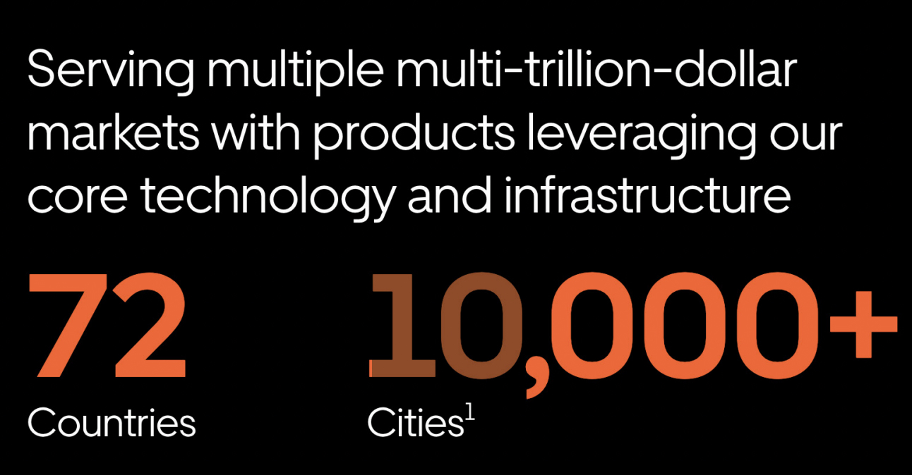
2. Uber Eats - крупнейшая в мире платформа доставки еды в мире (за пределами Китая)
3. Миллионы водителей-партнеров и более 130 миллионов пользователей пассажиров.
4. Десятки услуг, чтобы вы могли добраться куда угодно или получить что угодно.
5. Миллиарды транзакций в базе данных и миллионы одновременных пользователей в десятках приложений и тысячах бэкэнд-сервисов.

# Масштаб
## Что делает система
Uber — двусторонний рынок в реальном времени. С одной стороны пассажиры, с другой — водители. В интернет-магазине товар лежит на складе и никуда не едет. У Uber обе стороны рынка двигаются:
- Спрос динамический: пассажир заказывает поездку в любой момент из любой точки.
- Предложение динамическое: водитель меняет позицию каждую секунду.

Система знает, где находится каждый водитель. За секунды она выбирает лучшего водителя для каждого заказа. Поэтому Uber — прежде всего система реального времени, а уже потом приложение для заказа.

## Масштаб сегодня
| Метрика | Значение |
|---|---|
| Страны и города | 70+ стран, 10 500+ городов |
| Активные пользователи в месяц (MAPC) | 208 млн (Q2 2026) |
| Поездки и доставки | 3,9 млрд за квартал (Q2 2026) ≈ 42 млн в день |
| Водители и курьеры | ~10 млн (конец 2025) |
| Бэкенд | 4 000+ stateless-микросервисов, 250 000+ серверов |
| Хранилища | десятки ПБ данных, десятки млн запросов в секунду |
| Fulfillment (исполнение заказов) | 1 млн одновременных пользователей, миллиарды транзакций в день |

42 млн поездок в день — это около 500 поездок в секунду в среднем. Пик в разы выше: самая нагруженная ночь года — Новый год. Но заказы — не главная нагрузка. Поток координат от водителей в разы больше, о нём расскажем в разделе про гео-индекс.

## Как рос масштаб
| Год | Масштаб |
|---|---|
| 2009 | Друзья основателей в Сан-Франциско |
| 2011–2015 | Рост в 38 раз за 4 года |
| 2014 | Поездки растут на ~20 % в месяц |
| Декабрь 2015 | 1 млрд поездок |
| 2016 | 2 млрд поездок |
| Май 2017 | 5 млрд поездок |
| Июнь 2018 | 10 млрд поездок, 600 городов |
| Q2 2026 | 3,9 млрд поездок за один квартал |

За первые 8 лет Uber набрал 5 млрд поездок. Сейчас почти столько же он делает за один квартал. В 2014 году поездки росли на 20 % в месяц. При таком росте нагрузка удваивается примерно каждые 4 месяца.

Поэтому Uber несколько раз переписывал ключевые системы. Решение, которое работало год назад, переставало справляться. Дальше разберём требования к системе, а потом — как Uber выполнял их на каждом этапе.

# Требования
Перед историей разберём, что система должна уметь. Требования почти не менялись с 2009 года. Менялись масштаб и способы их выполнить.

## Функциональные требования
Ядро Uber — путь одного заказа:
1. Пассажир указывает точку посадки и точку назначения. Система показывает цену и ETA (расчётное время прибытия).
2. Пассажир заказывает поездку по этой цене.
3. Система находит ближайшего свободного водителя. Этот шаг дальше называем матчингом.
4. Водитель принимает или отклоняет заказ.
5. Водитель едет к пассажиру, а потом к точке назначения.
6. Пассажир видит машину на карте в реальном времени.

Оплата, рейтинги и Uber Eats — отдельные большие системы. В рассказе они появятся только там, где повлияли на архитектуру.

## Нефункциональные требования
| Требование | Цель | Почему |
|---|---|---|
| Время матчинга | < 1 мин | Если ждать долго, пассажир уходит к конкуренту |
| Консистентность матчинга | строгая | Один водитель — один заказ |
| Пиковая нагрузка | 100 тыс. заказов из одной зоны | Концерт, матч, Новый год |
| Доступность | 99,99 % | Конкурент — в соседнем приложении |
| Свежесть координат | 4–5 с | Старая позиция даёт неверный ETA |
| Сохранность поездки | без потерь при отказе дата-центра | Поездка — это деньги и безопасность людей |
| Идемпотентность | любой запрос можно повторить | Повтор не создаёт второй заказ или второе списание |

Главная особенность Uber — разные данные требуют разной консистентности (согласованности данных). Координатам водителей хватает итоговой согласованности: позиция 5-секундной давности не критична. Матчингу и деньгам нужна строгая консистентность. Два водителя на один заказ — реальная проблема первой версии Uber, о ней расскажем дальше.

Мобильная сеть нестабильна, поэтому приложение повторяет запросы. Повтор не должен отправить вторую машину или списать деньги дважды.

# История развития
## Первое приложение - 2009 год
Первый прототип был написан в 2009 году и использовал стек `LAMP` (Linux, Apache, MySql, Perl/PHP/Python).
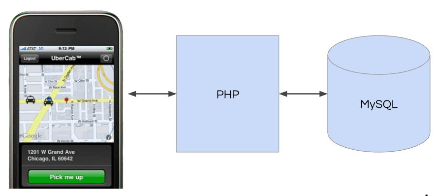
Первый запуск произошел в Сан-Франциско и пользовались приложением друзья создателей. По началу такого решения более чем хватало, однако с ростом пользователей стала очевидна следующая проблема масштабирования такого решения:  [довольно часто возникали проблемы с параллельным выполнением задач, когда приложение отправляло две машины одному человеку или один водитель назначался двум разным пассажирам.](https://www.youtube.com/watch?v=fO83dyxa0Vo)

Но уже в это время приложение начало пользоваться успехом и поэтому было принято решение разработать с нуля архитектуру приложения.

## Переработка архитектуры - 2011 год
Были поставлены следующие задачи для масштабированяи своего решения: 
1. Параллельное выполнение задач.
2. Обработка большого количества данных в realtime.
3. Обработка запросов от пассажирова.
4. Отслеживание местоположения водителей в realtime для более лучшего подбора.

Для всех задач, связанных с realtime проблемами был выбран Node.js по нескольким причинам:
1. Обработка запросов асинхронно (event-loop).
2. JS v8 - производительность и быстрая итерация.

Затем Uber создала второй сервис на языке Python для обработки бизнес-логики, такой как аутентификация, проведение акций и расчет стоимости поездки.

В результате получилась архитектура из двух сервисов. Один был создан на Node.js («dispatch») и подключен к MongoDB (позже Redis), а другой — на Python («API») и подключен к PostgreSQL.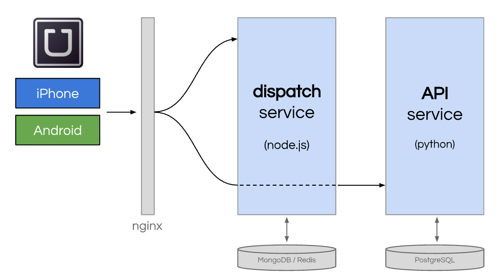

Также для повышения надежности работы основного процесса диспетчеризации Uber был создан слой между диспетчеризацией и API, известный как «ON» или Object Node, способный противостоять любым сбоям в работе API-сервиса. Архитектура приложения стала походить на сервисно-ориентированную архитектуру, что позволяло делить инженеров на более специализированные команды, что вело к лучшего масштабированию команд.
Однако, с ростом количества нового функционала появилась новая проблема - трудное развертывание, множество конфликтов в функциях, рост кодовой базы API-сервиса. Было принято решение внедрять микросервисную архитектуру.

## Микросервисы - ~2013 год
Для следующего этапа роста Uber решил внедрить микросервисную архитектуру. Этот уже широко известный шаблон проектирования предлагает разработчикам разделять монолиты на небольшие сервисы, предназначенных для конкретных, хорошо инкапсулированных предметных областей.
Например, в рамках Uber это были такие сервисы как 
1. Выставление счетов пассажирам. 
2. Выплаты водителям.
3. Обнаружение мошенничества.
4. Аналитика и тд. 

Большинство микросервисов были написаны на Python с использованием Tornado. 
Tornado - это Python-фреймворк для веба и асинхронного сетевого ввода-вывода. 
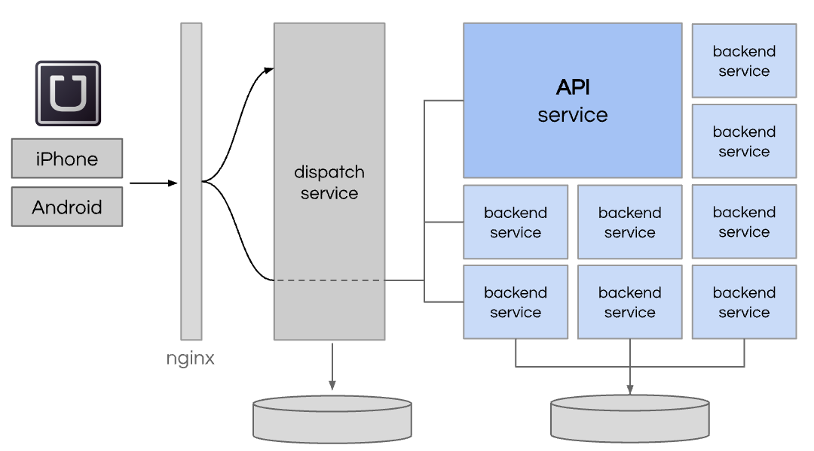
В 2014 году у uber уже было около 100 микросервисов. Они понимали, что микросервисная архитектура такого масштаба решала многие проблемы, но и вносила операционную сложность и для поддержки такого количества микросервисов иногда приходилось идти на компромиссы. Инженеры Uber это понимали. Вот примеры этих проблем и как они их решали:

1. Нету стандартизированного сервисного фреймворка? Разработаем `Clay`. `Clay` - обертка над `Flask` для разработки restful backend сервисов. Он позволил им создавать сервисы с одинаковыми мониторингом, логированием, HTTP-запросами, деплоем и т.д.
2. Сервисам нужно как-то находить друг друга, общаться и не падать от сбоев соседей? Сделаем `TChannel` поверх `Hyperbahn` - двунаправленный RPC-протокол для повышения производительности и улучшения обменом данными между сервисами на `Node` и `Python`.
3. Интерфейсы между сервисами размытые, контракты слабые? Возьмем `Apache Thrift`. В нем RPC-интерфейс описывается строго, и обе стороны работают по одному контракту. 
4. Изменение в одном сервисе ломает совместимость с другими? Заведем `Flipr`. Это feature flags: прячем изменения за флагом, управляем раскаткой и кучей других настроек через конфиг.
5. Непонятно, что творится с сервисами? Сделаем платформу сбора метрик `M3`, а для масштабных алертов используем `Nagios`.
6. Нужна распределенная трассировка запроса? Создадим `Merckx` - собирает данные из потока инструментирования через `Kafka`. Но как начался переход на асинхронные паттерны взаимодействия, потребовалось эволюционировать решение. Вдохновившись `Zipkin`, Uber создали `Jaeger` и до сих пор пользуются им в разработке.

## Переход с `Postgresql` на `MySql` - 2014
В 2014 году, когда активно происходил переход на микросервисную архитектуру, Uber все также продолжал пользоваться единственным экземпляром `PostgreSQL`, на котором находились почти все данные. 
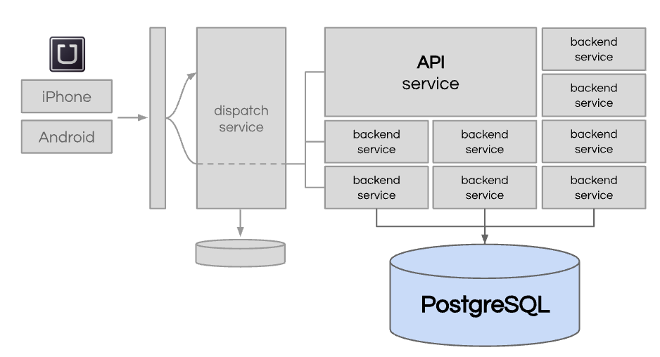

На что это влияло:
1. Производительность - база данных была бутылочным горлышком.
2. Масштабируемость и доступность оставляли желать лучшего.
3. Вертикальное масштабирование уже почти не помогало.
4. Стало трудно поддерживать такое решение. Любые изменения будь то новые строки, таблицы или индексы становились головной болью. 
5. Технические претензии к PostgreSQL: Uber не нравилось то, как PostgreSQL хранит строки. 

В 2014 году, за 6 месяцев до Хеллуина они решили, что им нужно более масштабируемое решение. Начали анализировать структуру зранимых данных и поняли, что большая часть была связана с поездками.
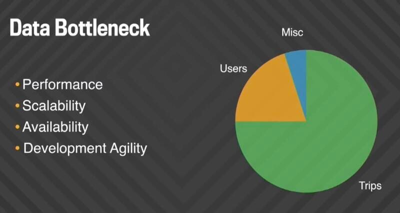

Проанализировав `Cassandra`, `Riak` и `MongoDB`, поняли, что ни одна не подходит по всем требованиям в срок для поездок. Тогда команда построила `Schemaless` поверх `MySQL`.
Для других данных постепенно стали использовать `Cassandra`. 

### Почему MySQL
Но сначала про конкретные претензии к Postgres.
- У каждой версии строки есть физический адрес (ctid), и все индексы ссылаются на этот адрес. `UPDATE` не меняет строку на месте: он пишет новую версию строки в новое место (так устроен MVCC). 
- MySQL (InnoDB). Вторичные индексы ссылаются на первичный ключ, а не на физический адрес. Строка обновляется на месте, а старая версия уходит в undo log.
Отсюда возникали проблемы:

1. **Усиление записи (write amplification).**
В `Postgres` `UPDATE` не меняет строку на месте. Он записывает новую версию строки в другое место на диске, а старую помечает удалённой (так Postgres даёт параллельным транзакциям видеть старые данные). Все индексы таблицы хранят физический адрес строки. Адрес поменялся, значит, нужно обновить все индексы, даже если изменилось одно неиндексированное поле. У таблицы 10 индексов — один UPDATE превращается в 11 записей на диск.
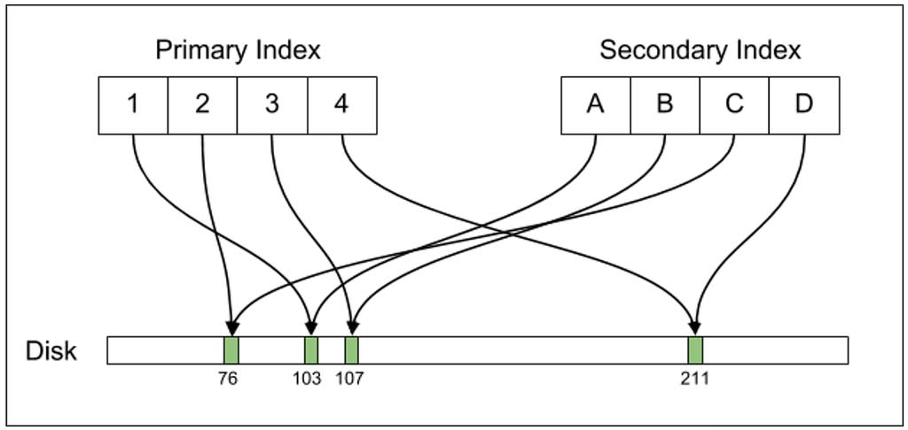
В `MySQL` (InnoDB) индексы ссылаются на первичный ключ, а не на адрес. Строка обновляется на месте, и индексы не трогаются, если их поля не менялись.
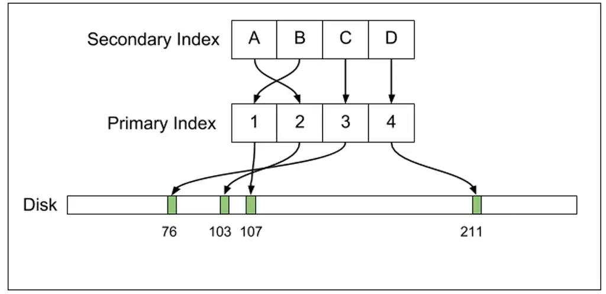

2. **Тяжёлая репликация.**
Репликация — это постоянное копирование изменений с главного сервера на реплики. Postgres передаёт свой журнал WAL, то есть низкоуровневый лог: какие байты на каких страницах диска поменялись, включая все обновления индексов из пункта 1. Объём огромный, а Uber реплицировал между дата-центрами, где трафик дорогой.
MySQL передаёт логический журнал (binlog): «в строке с id=123 поле price стало 500». Он в разы компактнее.

3. **Порча данных расходится по репликам.**
WAL копирует изменения байт в байт. Когда Uber столкнулся с багом в Postgres, повреждённые данные сразу попали на все реплики.
При логической репликации каждая реплика сама применяет изменения, поэтому баг обычно ломает одну реплику, а не все.

4. **Долгие запросы на репликах.**
Реплика Postgres применяет WAL и одновременно отвечает на запросы на чтение. Если долгий запрос читает данные, которые WAL хочет изменить, возникает конфликт. Postgres либо убивает запрос по таймауту, либо приостанавливает применение WAL, и реплика отстаёт от мастера.
В MySQL реплика спокойно делает и то и другое.

5. **Обновление версий только с простоем.**
WAL-репликация работает только между одинаковыми мажорными версиями Postgres. Поэтому нельзя обновить реплики заранее: обновлять приходится всё сразу через `pg_upgrade`, а на большой базе это часы простоя.
В MySQL реплики можно обновить по одной, затем переключить на новую версию роль мастера. Простоя нет.

6. **Дорогие соединения.**
Postgres создаёт отдельный процесс ОС на каждое соединение. Процесс тяжёлый, поэтому тысячи соединений съедают память. Нужен пулер соединений (`pgbouncer`), а у Uber были инциденты из-за слишком большого числа соединений.
MySQL создаёт на соединение поток, это заметно дешевле.

7. **Кэш.**
Postgres кэширует данные через кэш операционной системы, поэтому даже чтение из кэша идёт через системный вызов. У InnoDB свой кэш (buffer pool) прямо в памяти процесса, и он работает быстрее. Это второстепенный пункт.

### Shemaless
`Schemaless` — хранилище, которое Uber построил в 2014 году для данных о поездках. Это слой поверх MySQL, сделанный по модели Google Bigtable. Сервисы обращаются к `Schemaless`, а он сам решает, в какой MySQL-сервер писать.

- **Модель данных.**
    * Адрес ячейки: row_key (UUID поездки) + column_name (например, BASE) + ref_key (версия). Значение — JSON.
    * Append-only: ячейку нельзя изменить. Обновление — это новая ячейка с бо́льшим ref_key, поэтому вся история сохраняется.
    * Schemaless: база не проверяет структуру JSON, схема живёт в коде. Новое поле добавляется без ALTER TABLE.

- **Масштабирование**. Данные разбиты на 4 096 шардов по хэшу row_key. Нужно больше места — шарды переносят на новые серверы. В каждом кластере мастер и две реплики в разных дата-центрах.

- **Ключевые фичи.**
    * Триггеры: сервис подписывается на колонку и реагирует на новые ячейки. Например, появилась BASE (поездка завершена) — биллинг списывает деньги.
    * Вторичные индексы по полям JSON, обновляются с небольшой задержкой.
    * Buffered writes: если мастер упал, запись не теряется, а ждёт в буфере на другом кластере.

- **Почему подошло?** Горизонтальное масштабирование и схема без миграций. MySQL используется просто: только вставка и чтение по ключу, поэтому проблемы, которые были с Postgres, здесь не возникают.

- **Минусы.** Нет транзакций, SQL и JOIN. Индексы и реплики обновляются с задержкой (eventually consistent).

### Миграция - Project Mezzanine
Переход на `Schemaless` назвали Project Mezzanine. От идеи до продакшена прошло около 5 месяцев. Последние 6 недель команда работала в war room (общем штабе миграции).

Что сделали:
1. Заменили ID поездок на UUID и переписали сотни SQL-запросов.
2. Включили двойную запись: данные писали и в `PostgreSQL`, и в `Schemaless`.
3. В фоне сравнивали ответы двух баз.
4. В конце сентября 2014 года переключились на `Schemaless`.

Переключение прошло за месяц до Хэллоуина, без алертов и инцидентов. Позже ёмкость хранилища удвоили без простоя.

## Разделение dispatch - 2014-2015
В 2014 году dispatch делал две работы. Первая — матчинг. Вторая — проксирование: весь трафик мобильных приложений шёл через dispatch к остальным сервисам.

Кроме того, старый dispatch знал только модель «один водитель — один пассажир». Еду и посылки он возить не умел. Состояние водителей шардировали по городам, и крупные города перерастали свой шард.

Поэтому dispatch разделили на две части:
- `RTAPI` (Real-Time API) — шлюз для мобильных приложений на `Node.js`. Он принимает все запросы и направляет их в нужный сервис.
- Новый dispatch — набор сервисов, которые отвечают только за матчинг.

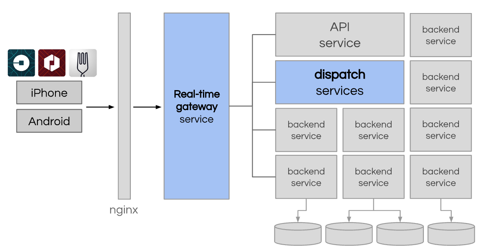

Со временем через `RTAPI` пошли все продукты Uber. Тогда его разделили на группы API. Код остался в одном репозитории, но каждая группа развёртывается отдельно. Сбой одной группы не ломает остальные.

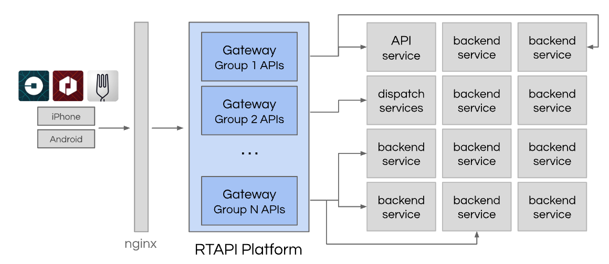

Новый dispatch состоит из четырёх частей:
- `rt-supply` (Supply Service) — водители, их машины и состояние.
- `rt-demand` (Demand Service) — заказы и требования пассажиров. Позже сюда добавили еду и посылки.
- Geospatial Index (гео-индекс) — где сейчас находится каждый водитель.
- Matching Engine, он же DISCO (dispatch optimization), — матчинг заказов и водителей.

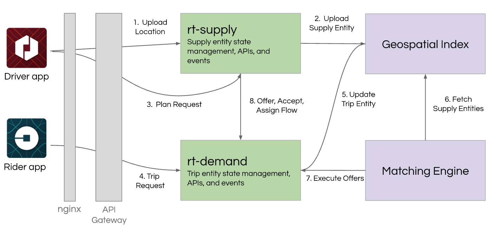

Как заказ проходит по схеме:
1. Приложение водителя отправляет координаты в `rt-supply`. Он обновляет гео-индекс.
2. Пассажир создаёт заказ в `rt-demand`. Заказ тоже попадает в гео-индекс.
3. Matching Engine берёт из гео-индекса водителей рядом и выбирает лучшего.
4. `rt-demand` и `rt-supply` отправляют предложение водителю. Водитель принимает заказ, и система назначает его на поездку.

Новый матчинг смотрит не только на свободных водителей, но и на тех, кто скоро освободится. Занятый водитель рядом может оказаться лучше свободного водителя далеко.

### Гео-индекс и Ringpop
Главная нагрузка на dispatch — не заказы, а координаты. Каждый водитель онлайн отправляет координаты раз в 4 секунды. Гео-индекс проектировали на 1 млн записей в секунду. Поэтому координаты хранят в памяти, а не в базе данных.

Гео-индекс построен на библиотеке Google `S2`:
- `S2` делит Землю на ячейки, у каждой ячейки свой ID.
- Uber использует уровень 12: ячейка площадью 3–6 км².
- ID ячейки — ключ шардирования. Координаты водителя попадают в шард своей ячейки.
- Чтобы найти водителей рядом, система покрывает круг вокруг пассажира ячейками и опрашивает их шарды.

Матчинг идёт в три шага:
1. Гео-индекс отбирает водителей рядом.
2. Сервис маршрутов считает ETA по дорогам, а не по прямой.
3. Система сортирует водителей по ETA и предлагает заказ лучшему.

Сервисы dispatch хранят состояние в памяти. Поэтому их нельзя просто запустить в нескольких копиях, как stateless-сервис (сервис без состояния). Для этого Uber написал библиотеку `Ringpop` на `Node.js`:
- consistent hashing (консистентное хеширование) распределяет ключи по кольцу узлов;
- gossip-протокол на базе SWIM узнаёт, какие узлы живы: узлы постоянно обмениваются информацией друг о друге;
- любой узел принимает запрос и пересылает его узлу-владельцу ключа.

`Ringpop` работает на тысячах узлов. При сбое сети он выбирает доступность, а не консистентность. Через несколько лет это решение станет главной проблемой dispatch.

## Принципы надёжности - 2015
В 2015 году главный архитектор Uber Мэтт Рэнни сформулировал принципы надёжности. Главная идея: сбой — это норма, а не исключение.
- Любой запрос можно повторить: все запросы идемпотентны.
- Любой процесс можно убить в любой момент. Uber не делает graceful shutdown (плавную остановку) и тестирует только внезапные падения. Этот подход называют crash-only.
- Систему собирают из мелких частей. Пара серверов — плохая схема: потеря одного из двух забирает 50 % мощности.
- Убивать можно всё, включая базы данных.
- Backup requests (резервные запросы): запрос уходит в одну реплику, а с небольшой задержкой — во вторую. Первый ответ отменяет второй запрос.

Самое интересное — восстановление после отказа дата-центра. Uber не копировал данные поездок между дата-центрами. Вместо этого dispatch периодически отправлял на телефон водителя зашифрованную сводку поездки (state digest).

Если дата-центр падает, приложение переключается на резервный. Телефон присылает координаты по поездке, которую резервный дата-центр не знает. Dispatch запрашивает у телефона сводку и восстанавливает поездку. Пассажир и водитель сбоя не замечают.

## Мобильная разработка
В 2016 году проблема монолита появилась и в мобильных приложениях. Сотни инженеров работали в одной кодовой базе, а релиз был один на всех.

Uber переписал приложение пассажира на архитектуру RIBs (Router, Interactor, Builder). Каждая часть экрана — отдельный модуль со своей командой. Код разделили на основной и дополнительный. Основной код проходит строгое ревью, а дополнительный включают через feature flags.

## Взлёт Uber Eats
Uber Eats запустили в конце 2015 года в Торонто. Команда взяла готовое: матчинг, исполнение заказа и оплату. Новыми были только меню, корзина, поиск и каталог. Первая версия целиком жила в шлюзе `RTAPI`.

Рынок стал трёхсторонним: клиент, ресторан и курьер. Позже в одном заказе стало бывать несколько клиентов, ресторанов или курьеров. Модель «один клиент — один ресторан — один курьер» перестала подходить. Это одна из причин, почему в 2021 году Uber переписал исполнение заказов.

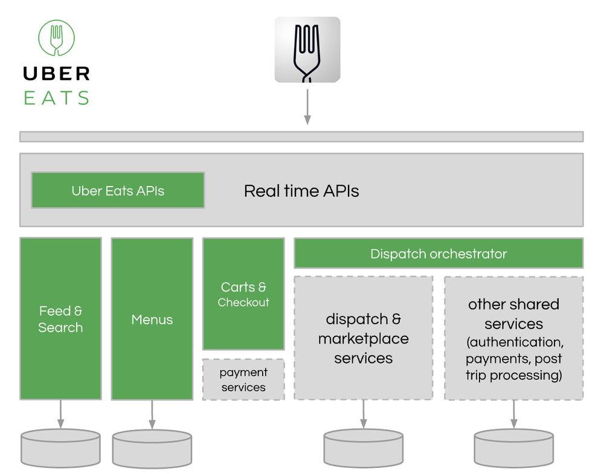

## Project Ark и H3 - 2018
К 2018 году Uber работал в 600 городах. Культура «Let Builders Build» («пусть инженеры строят») помогла быстро расти, но принесла хаос:
- тысячи микросервисов и 12 000 репозиториев;
- несколько очередей, баз данных, протоколов и языков для одних и тех же задач;
- по словам CTO Uber Туана Фама, «пять-шесть систем бонусов, похожих друг на друга на 75 %».

Project Ark ввёл стандарты:
- Основные языки бэкенда — `Java` и `Go`. `Python` и `JavaScript` стали устаревшими.
- Репозитории свели к основным языкам: `Java`, `Go`, iOS, Android, web.
- Сервисы строят по стандартным слоям: клиент, представление, продукт, бизнес-логика.
- Трассировку, логирование, сеть и отказоустойчивость дают общие библиотеки.

В том же году Uber открыл исходный код `H3` — гео-индекса из шестиугольников. У квадратной ячейки соседи на двух разных расстояниях: по сторонам и по углам. У шестиугольника все 6 соседей на одном расстоянии от центра. Поэтому спрос и предложение удобно сглаживать по соседним ячейкам.

У `H3` 16 уровней детализации. Ячейка следующего уровня примерно в 7 раз меньше. На `H3` работают surge pricing (динамическое ценообразование), dispatch и аналитика рынка.

## DOMA и Edge Gateway - 2020
К 2020 году у Uber было около 2 200 критичных микросервисов. Независимость команд пропала:
- чтобы найти ошибку, инженер проходил около 50 сервисов 12 команд;
- простая фича требовала работы многих команд;
- сервисы приходилось деплоить вместе.

Получился распределённый монолит. Решение — DOMA (Domain-Oriented Microservice Architecture, доменно-ориентированная микросервисная архитектура):
- Домен — группа сервисов по смыслу: карты, цены, матчинг.
- Слои: сервис может зависеть только от сервисов нижних слоёв.
- Шлюз — одна точка входа в домен. Другие команды видят API домена, а не десятки его сервисов.
- Точки расширения: команда добавляет свою логику без правки ядра домена.

Параллельно Uber заменил `RTAPI`. За годы в нём смешались логика экранов и бизнес-логика. Новый `Edge Gateway` отвечает только за жизненный цикл API. Логику разнесли по слоям: Edge → Presentation → Product → Domain.

Результат: 2 200 сервисов сгруппировали в 70 доменов. Интеграция новой фичи ускорилась с 3 дней до 3 часов. Новые инженеры входят в работу на 25–50 % быстрее.

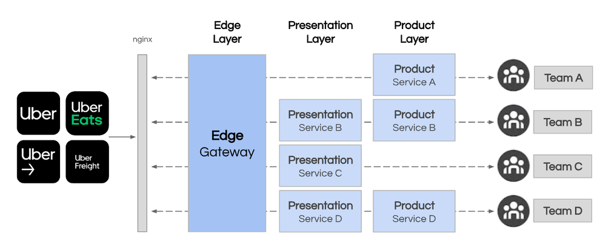

## Docstore и Spanner - 2020-2021
Этот этап — разворот от доступности к консистентности.

### Docstore
`Schemaless` вырос в `Docstore` — транзакционную базу данных поверх `MySQL`. Транзакции внутри партиции выполняются так, будто идут строго по очереди. Реплики договариваются о порядке записей через Raft. Вместе со `Schemaless` это десятки петабайт данных и десятки миллионов запросов в секунду.

### Fulfillment Platform на Spanner
Fulfillment Platform (платформа исполнения заказов) ведёт заказы и водителей от создания заказа до конца поездки. В 2021 году её переписали с нуля. Проблемы старой платформы:
- `Ringpop` и `Cassandra` выбирали доступность. При split-brain (кластер разделился, и каждая часть работает сама по себе) данные расходились.
- Изменение нескольких сущностей шло цепочкой RPC-вызовов. Между вызовами данные были несогласованными.
- Ядро меняли 400+ инженеров без общих правил.

Новые сценарии требовали менять несколько сущностей атомарно: бронь водителя заранее, несколько заказов одному курьеру, виртуальная очередь в аэропорту. Требования к новой платформе: транзакции между регионами, SLA 99,99 %, никаких потерь данных, смена схемы без простоя.

Uber сравнил три варианта: доработать NoSQL, построить своё на `MySQL` или взять NewSQL. Выбрали Google Cloud `Spanner`. Он даёт ACID-транзакции между шардами: изменение применяется целиком или не применяется совсем. Шардирует данные `Spanner` сам. Сейчас платформа поддерживает 120+ сценариев исполнения заказа и 1 млн одновременных пользователей.

## Облако - 2023+
Uber с первых лет работал в своих дата-центрах. К 2023 году там стояло 250 000+ серверов. Обслуживать такой парк — отдельная большая работа:
- инструменты не успевают за ростом парка;
- новый регион требует нового дата-центра;
- размер парка нужно постоянно подбирать под нагрузку.

Uber сделал 4 000+ stateless-микросервисов переносимыми. Project Crane дал единый стек для облака и своих дата-центров. Теперь Uber переносит нагрузку в Google Cloud и Oracle Cloud.

Похожий путь прошёл поиск:
1. Сначала Uber взял `Elasticsearch`.
2. В 2019 году построил свой движок `Sia` для поиска в реальном времени.
3. В 2024 году перешёл на `OpenSearch` и отдал туда свои улучшения. Свой движок оказалось слишком дорого поддерживать.

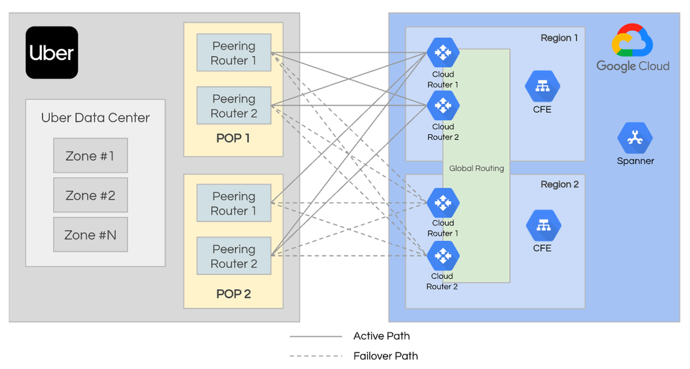

# Выводы
## Цикл, который повторяет Uber
В истории Uber один цикл повторяется много раз:

| Этап | Что делает Uber | Примеры |
|---|---|---|
| Старт | Берёт готовые инструменты | `PostgreSQL`, `Elasticsearch`, `Node.js` |
| Быстрый рост | Строит свои системы | `Schemaless`, `Ringpop`, `TChannel`, `Sia` |
| Стабилизация | Упрощает и возвращается к стандартам | `Spanner`, `Docstore`, `OpenSearch`, DOMA |

На старте важна скорость, поэтому Uber берёт готовое. При росте на 20 % в месяц, как в 2014 году, готовые инструменты не успевают, и Uber строит свои. Когда рост замедляется, свои системы становятся дорогими в поддержке. Тогда Uber упрощает архитектуру и возвращается к стандартным решениям.

## Уроки
1. Разные данные требуют разной консистентности. Координатам хватает итоговой согласованности, матчингу и деньгам нужна строгая.
2. Главная нагрузка — поток координат, а не заказы.
3. Микросервисы без инструментов и границ превращаются в распределённый монолит.
4. Данные переносят через двойную запись и сверку, а не одним переключением.
5. Своя система оправдана, пока стандартная не справляется. Потом её стоит заменить.

Архитектура Uber — не одна правильная схема, а цепочка решений под текущий масштаб. Требования остались те же: найти водителя за секунды, не назначить его дважды и не потерять поездку. Менялись нагрузка, размер команды и инструменты. Поэтому копировать «как у Uber» не стоит: решение нужно обосновывать своим масштабом.
