# Задание 3. Мультиагентная система

Медиа-ассистент — мультиагентная система на локальных LLM. Она отвечает на вопросы о видео, аудио, картинках и CSV. ML-модели из задания 1 работают как тулы агентов. Код агентов выполняется в microVM.

Репозиторий: https://github.com/Zancrow20/LLMs

Готовы разделы плана 3–7: окружение, выбор LLM, ТЗ, архитектура, каркас графа и роутинг. Остальные разделы появятся по ходу работы.

## Как запустить

Сейчас работает бенчмарк LLM:

```bash
brew install ollama structurizr
brew services start ollama
for m in qwen3.5:9b qwen3.5:4b gemma4:e4b gemma4:12b gpt-oss:20b strands-decider; do ollama pull $m; done
uv sync
uv run python task3-agent/evals/llm_bench.py            # все кандидаты, thinking выключен
uv run python task3-agent/evals/llm_bench.py --report   # сводная таблица в evals/results/summary.md
```

Граф агентов (каркас; тулы media — раздел 10, песочница для `run_python` — раздел 9):

```bash
cd task3-agent && uv sync
uv run python -m agent.graph "Что ты умеешь?"     # THREAD=имя — своя ветка короткой памяти
```

## Ход работы и флоу вайбкодинга

Ход работы, проблемы и решения записаны в [JOURNAL.md](JOURNAL.md).

Код и документы написаны с Claude Code (модель Claude Opus 5.5) в VS Code. Правила для агента-кодера лежат в [CLAUDE.md](../CLAUDE.md): без эмодзи, короткие комментарии, `uv add`, evals перед коммитом. Скиллы и MCP-серверы, ключевые промпты и расход токенов по дням — в журнале.

## ТЗ агента

Полное ТЗ — [SPEC.md](SPEC.md): 7 сценариев, 14 функциональных и 9 нефункциональных требований, критерии приёмки. Главные ограничения: работа офлайн, 24 ГБ памяти, код только в песочнице, p95 ответа по видео до 60 с.

---

## 1. Выбор движка и LLM

### 1.1 Движок

Движок | GPU на Mac (Metal) | OpenAI-совместимый API | Decision-модели | Заметка
---|---|---|---|---
**Ollama** | да | да | да, `/v1/systemone` | выбран
llama.cpp (`llama-server`) | да | да | нет | Ollama работает поверх него
MLX-LM | да | да (`mlx_lm.server`) | нет | движок Apple; в Ollama есть MLX-теги моделей
vLLM | нет, на Mac только CPU | да | нет | основная платформа — CUDA
LM Studio | да | да | нет | GUI; приложение проприетарное

Почему Ollama:

- работает на Metal GPU этой машины (Apple M5, 24 ГБ);
- единственный из списка запускает decision-модели (Jev-like) через `/v1/systemone`;
- поддерживает tool calling и OpenAI-совместимый API, с ним работают LangChain и Graphiti;
- скачивает и переключает модели одной командой;
- лицензия MIT.

Минус: меньше настроек инференса, чем у `llama-server`, и ниже пропускная способность на много параллельных запросов, чем у vLLM. Для одного пользователя на ноутбуке это не важно.

### 1.2 Кандидаты

Модель | Семейство | Параметры, квантование, контекст | Файл | Лицензия | Роль-кандидат
---|---|---|---|---|---
`qwen3:8b` | Qwen3, Alibaba | 8.2B, Q4_K_M, 40K | 5.2 ГБ | Apache 2.0 | прошлое поколение, для сравнения
`qwen3.5:4b` | Qwen3.5, Alibaba | 4.5B, NVFP4, 256K | 4.0 ГБ | Apache 2.0 | малая LLM
`qwen3.5:9b` | Qwen3.5, Alibaba | 9.7B, NVFP4, 256K | 7.6 ГБ | Apache 2.0 | основная LLM
`gemma4:e4b` | Gemma 4, Google | 8.1B (4B эффективных), NVFP4, 128K | 9.5 ГБ | Apache 2.0 | валидатор
`gemma4:12b` | Gemma 4, Google | 12.4B, NVFP4, 256K | 7.7 ГБ | Apache 2.0 | валидатор
`gpt-oss:20b` | gpt-oss, OpenAI | 20.9B MoE, MXFP4, 128K | 13 ГБ | Apache 2.0 | основная LLM или судья
`strands-decider` | Strands Agents, база Qwen3.5-2B | 1.9B, MXFP8, 4K | 2.0 ГБ | Apache 2.0 | decision-модель

Принцип отбора: модели 2026 года, которые помещаются в 24 ГБ вместе с остальной системой, поддерживают tool calling и выходят под открытой лицензией. `qwen3:8b` осталась в списке, чтобы показать разницу между поколениями.

### 1.3 Бенчмарк

Скрипт [evals/llm_bench.py](evals/llm_bench.py) прогоняет 43 задачи из [evals/bench_tasks.jsonl](evals/bench_tasks.jsonl). Параметры одинаковые для всех моделей: `temperature` 0, `num_ctx` 32768.

Категория | Что проверяет | Задач | Как проверяется
---|---|---|---
tools | выбор тула и аргументов; отказ от тула, когда он не нужен | 15 | имя первого tool call и аргументы
hallucination | вопросы о несуществующем и вопросы без ответа в контексте | 10 | ответ содержит отказ: «не знаю», «не существует», «в контексте нет»
format | ответ строго в JSON по описанной схеме, без constrained decoding | 5 | разбор JSON и проверка полей
reasoning | многошаговые задачи с проверяемым ответом | 5 | регулярное выражение по ответу
russian | грамматика, перевод, ответ на русском | 5 | регулярное выражение, доля кириллицы
long | факт в документе на 24 тыс. символов (12–15 тыс. токенов, зависит от токенизатора) в позициях 25%, 50%, 75% | 3 | регулярное выражение по ответу

Метрики скорости: tok/s генерации, p50 времени ответа без длинного контекста, RAM модели из `ollama ps`, время холодной загрузки.

#### Результаты

Прогон 2026-10-24: Ollama 0.40.10, Apple M5, 24 ГБ. Сырые ответы — `evals/results/bench-*.jsonl`, сводка — [evals/results/summary.md](evals/results/summary.md).

Модель | think | tools | hallucination | format | reasoning | russian | long | Итого | tok/s | p50, с | RAM, ГБ | Холодный старт, с
---|---|---|---|---|---|---|---|---|---|---|---|---
qwen3:8b | off | 13/15 | 10/10 | 5/5 | 5/5 | 3/5 | 3/3 | 39/43 | 25.7 | 1.9 | 7.2 | 2.6
qwen3.5:4b | off | 14/15 | 9/10 | 5/5 | 5/5 | 2/5 | 3/3 | 38/43 | 34.2 | 1.5 | 4.1 | 0.9
qwen3.5:9b | off | 15/15 | 9/10 | 5/5 | 5/5 | 2/5 | 3/3 | 39/43 | 34.9 | 1.4 | 7.7 | 2.2
**gemma4:e4b** | off | 15/15 | 10/10 | 5/5 | 5/5 | 5/5 | 3/3 | **43/43** | **69.7** | **0.4** | 9.4 | 3.0
gemma4:12b | off | 15/15 | 10/10 | 5/5 | 5/5 | 4/5 | 3/3 | 42/43 | 32.7 | 1.1 | 7.7 | 1.6
gpt-oss:20b | off | 14/15 | 10/10 | 5/5 | 5/5 | 5/5 | 3/3 | 42/43 | 34.2 | 1.3 | 12.8 | 6.2
gemma4:e4b | on | 15/15 | 9/10 | 5/5 | 5/5 | 5/5 | 3/3 | 42/43 | 84.9 | 2.7 | 9.4 | 2.5
qwen3.5:9b | on | 15/15 | 9/10 | 5/5 | 5/5 | 3/5 | 3/3 | 40/43 | 38.1 | 16.0 | 7.7 | 1.8

Для `gpt-oss:20b` «off» означает уровень рассуждения `low`: полностью рассуждение у этой модели не отключается.

Наблюдения:

- `gemma4:e4b` решила все 43 задачи и работает вдвое быстрее остальных: 70 tok/s, p50 0.4 с. Из 8.1B параметров на токен работает ~4B эффективных.
- Модели Qwen3.5 провалили русский: падеж («агентах» вместо «агентами»), исправление «пошол», подсчёт букв в слове «молоко».
- `qwen3:8b` и `qwen3.5:4b` в задачах про память не вызвали `memory_search`. `qwen3:8b` при этом выдумала содержание «прошлого анализа» видео — пример галлюцинации в агентном сценарии.
- `qwen3.5:9b` ответила «не знаю» про несуществующего профессора и тут же добавила, что он «известен работами в области квантовых…». Проверка `not_regex` засчитала это как галлюцинацию.
- Режим thinking не поднял точность: `gemma4:e4b` 42/43 против 43/43, `qwen3.5:9b` 40/43 против 39/43. p50 вырос в 7–11 раз.
- Structured output (параметр `format` с JSON-схемой) в Ollama 0.40.10 работает только для GGUF-моделей: `qwen3:8b` и `gpt-oss:20b`. Модели в NVFP4 на движке MLX (Qwen3.5, Gemma 4) отвечают HTTP 501 `structured output is unavailable`.
- Metal отдаёт GPU 17.8 ГБ из 24 ГБ unified memory. Модели сверх лимита Ollama выгружает.
- Обе модели Gemma 4 добавили эмодзи в ответ на «Привет! Как дела?». Требование NFR-7 запрещает эмодзи, поэтому нужны запрет в системном промпте и фильтр ответа. В сохранённых результатах эмодзи заменены меткой `[emoji]`, их число записано в поле `emoji`.

Ограничения бенчмарка: 43 задачи, поэтому разница в 1–2 задачи лежит в пределах шума. Проверки эвристические. Спорные ответы разобраны вручную, правки проверок записаны в [JOURNAL.md](JOURNAL.md).

#### Роли моделей

Роль | Модель | Почему
---|---|---
Основная LLM (tier `main`) | `gemma4:e4b` | Лучшие tool calling и формат (15/15, 5/5) при самой высокой скорости. Русский 5/5: ответы пользователю — на русском
Тяжёлая LLM (tier `heavy`) | `gpt-oss:20b`, рассуждение `high` | 42/43, reasoning 5/5. 12.8 ГБ: грузится по запросу, только для задач с `hard` > 0.85. Альтернатива — облачный API
Валидатор | `qwen3:8b` | Другое семейство: Alibaba против Google и OpenAI у генераторов. Галлюцинации 10/10, формат 5/5. GGUF, поэтому держит JSON-схему вердикта
`memory_writer`, LLM для Graphiti | `qwen3:8b` | Graphiti требует structured output. Модель уже загружена как валидатор
Decision-модель | `strands-decider` | Роутинг, гейт рискованного кода, решение о проверке

Роутинг по стоимости соответствует примеру из ТЗ: `gemma4:e4b` — изначально маленькая модель (~4B эффективных параметров), `gpt-oss:20b` — большая модель, квантованная в MXFP4. Большинство запросов обрабатывает быстрая модель. Тяжёлая загружается, только когда decision-модель оценила задачу как сложную.

Почему не остальные:

- `qwen3.5:9b`, `qwen3.5:4b` — русский 2/5, нет structured output в сборке MLX, медленнее `gemma4:e4b`.
- `gemma4:12b` — 42/43, но вдвое медленнее `gemma4:e4b`, длинный контекст 90 с против 22 с. То же семейство, что у основной модели, поэтому валидатором быть не может.
- `qwen3:8b` как основная — tool calling 13/15, выдумывает память вместо вызова тула.

`qwen3:8b` — модель прошлого поколения (апрель 2025). Её выбор обоснован замерами: лучший результат по галлюцинациям среди моделей другого семейства, которые помещаются в память вместе с основной, плюс поддержка JSON-схемы. Если появятся GGUF-теги Qwen3.5, валидатор стоит переизмерить.

Thinking по умолчанию выключен: на этих задачах он не даёт точности, но замедляет ответ в 7–11 раз.

### 1.4 Бюджет памяти

Замер `ollama ps` при одновременной загрузке:

Модель | `num_ctx` | Память, ГБ
---|---|---
`gemma4:e4b` | 32768 | 9.4
`qwen3:8b` | 8192 | 5.2
`strands-decider` | 4096 | 2.1
**Итого в GPU** | | **16.7 из 17.8**
`gpt-oss:20b`, по запросу | 32768 | 12.8

При `num_ctx` 32768 у валидатора три модели занимают 18.7 ГБ, и Ollama выгружает основную. Валидатору хватает 8192 токенов: на входе только черновик ответа и выводы тулов. `gpt-oss:20b` вытесняет остальные модели. Цена — холодный старт 6.2 с плюс повторная загрузка основной модели.

Вне Ollama память займут ML-модели задания 1 (~2 ГБ), microVM `sbx`, Langfuse и Grafana. Их замер — в разделе observability.

---

## 2. Архитектура

### 2.1 Агенты

Агент или узел | Модель | Тулы | Задача
---|---|---|---
`router` | `strands-decider` | — | тип задачи и сложность → выбор LLM
`orchestrator` | `gemma4:e4b`; `gpt-oss:20b` для сложных задач | `load_skill`, `memory_search` | план, делегирование, итоговый ответ
`media` | `gemma4:e4b` | MCP: `transcribe`, `sentiment`, `classify_image`, `detect_video` | анализ файлов
`analyst` | `gemma4:e4b`; `gpt-oss:20b` для сложных задач | `run_python` | расчёты и графики в песочнице
`validator` | `qwen3:8b` | — | проверка ответа по выводам тулов
`memory_writer` | `qwen3:8b` | Graphiti | извлечение фактов после ответа, фоном

Все агенты работают в одном графе LangGraph. Запрос проходит один флоу: роутер → оркестратор → специалисты → валидатор → ответ.

### 2.2 Паттерн

Выбрана комбинация трёх паттернов: supervisor, router и evaluator-optimizer.

Паттерн | Суть | Плюс | Минус | Решение
---|---|---|---|---
ReAct, один агент | один агент в цикле «рассуждение → тул → наблюдение» | просто | все роли и тулы в одном промпте, контекст растёт, нет независимой проверки | отказ
Plan-and-Execute | планировщик пишет план, исполнитель идёт по шагам | меньше вызовов сильной модели | план устаревает, если тул вернул неожиданное; нужен перепланировщик | частично: orchestrator планирует перед делегированием
**Supervisor** | центральный агент делегирует специалистам | явный контроль, простая трассировка, у специалистов узкие промпты и наборы тулов | оркестратор — узкое место и точка отказа; лишний вызов LLM на шаге | выбран
**Router** | лёгкий классификатор выбирает ветку и модель | дёшево и быстро | ошибка роутера ломает весь запрос | выбран, на decision-модели
**Evaluator-optimizer** | второй агент проверяет ответ и возвращает на доработку | ловит ошибки и галлюцинации | +1 вызов LLM, риск зацикливания | выбран: validator, не больше 2 повторов
Swarm (handoffs) | агенты передают управление друг другу | гибко, нет центра | путь запроса трудно предсказать и отладить | отказ
Хореография через события | агенты реагируют на события из шины | слабая связность, масштабируется | нет единой точки контроля, нужна шина сообщений | отказ
Blackboard | агенты читают и пишут общую доску | агента легко добавить | конфликты записи, неочевидный порядок | отказ
Иерархические команды | супервизоры над супервизорами | масштаб на десятки агентов | избыточно для 4 агентов | отказ

### 2.3 Слои агента

1. **Вход:** проверка типа и размера файла, запись в `workspace/`.
2. **Роутинг:** decision-модель определяет тип задачи и сложность.
3. **Планирование:** orchestrator строит план и выбирает агента.
4. **Действие:** агенты `media` и `analyst`, тулы.
5. **Верификация:** decision-гейт перед рискованным кодом и validator на LLM другого семейства.
6. **Память:** короткая (checkpointer), долгая (Graphiti), процедурная (скиллы, persona, промпты).
7. **Наблюдаемость:** трейсы, метрики и логи на каждом шаге.

### 2.4 Диаграммы

C4-модель написана в Structurizr DSL: [diagrams/workspace.dsl](diagrams/workspace.dsl). Code-уровень и UML sequence — в Mermaid: [diagrams/diagrams.md](diagrams/diagrams.md).

**System Landscape**

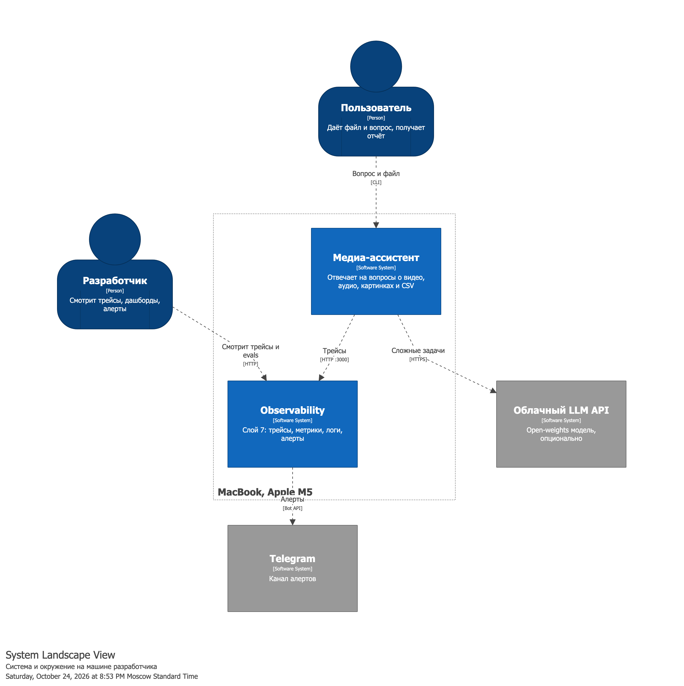

**System Context**

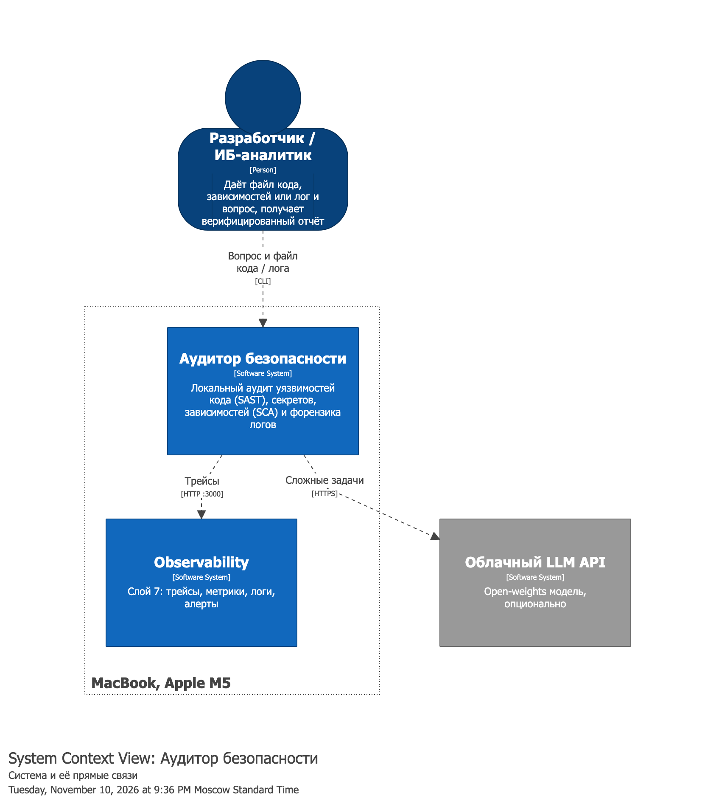

**Container.** Группы показывают границу microVM: агент и код внутри, Ollama и ML-тулы на хосте.

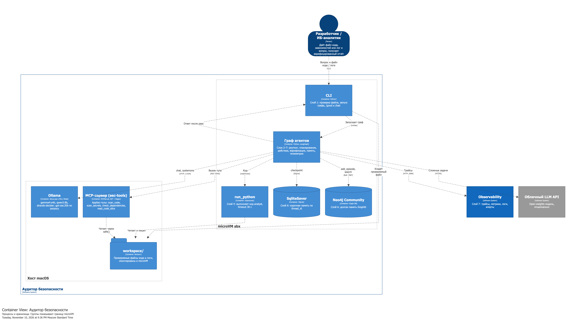

**Component.** Компоненты графа сгруппированы по 7 слоям агента.

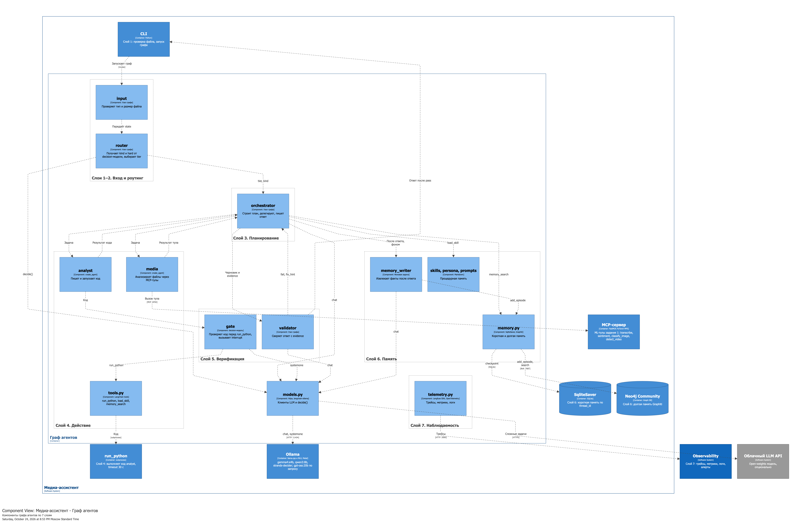

**Code.** Граф LangGraph и структура state.

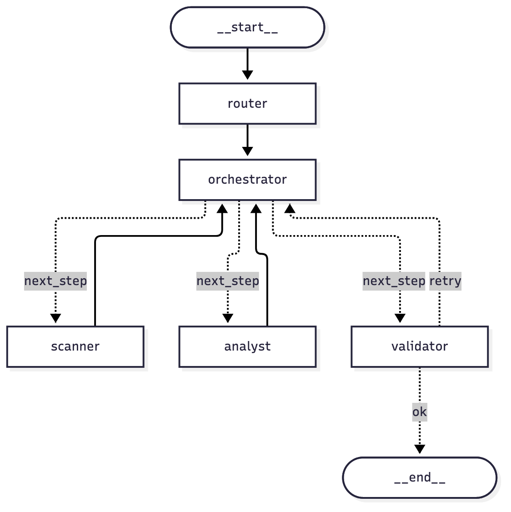

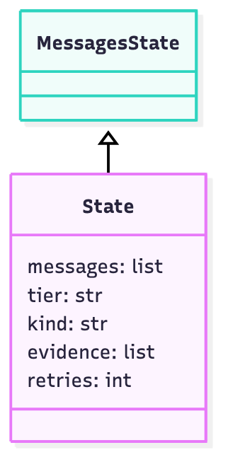

**Dynamic.** Сценарий «Сколько людей прошло в кадре?».

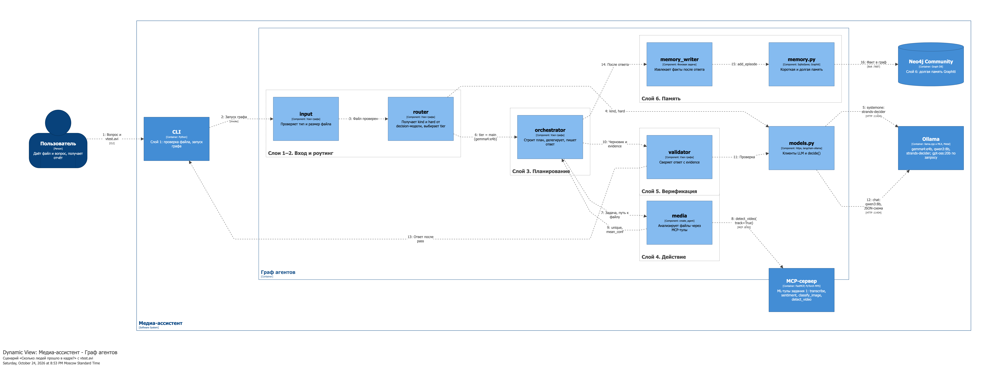

**Deployment**

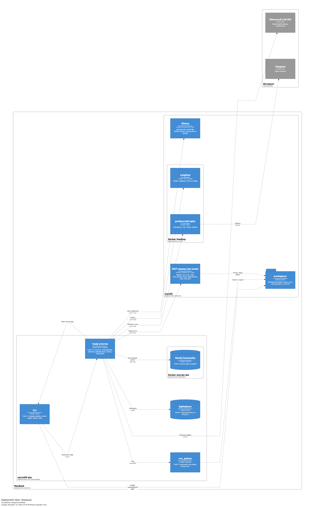

**Sequence-диаграммы**

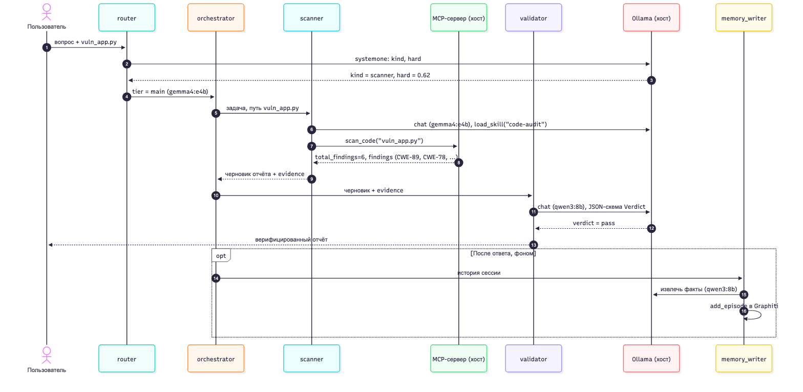

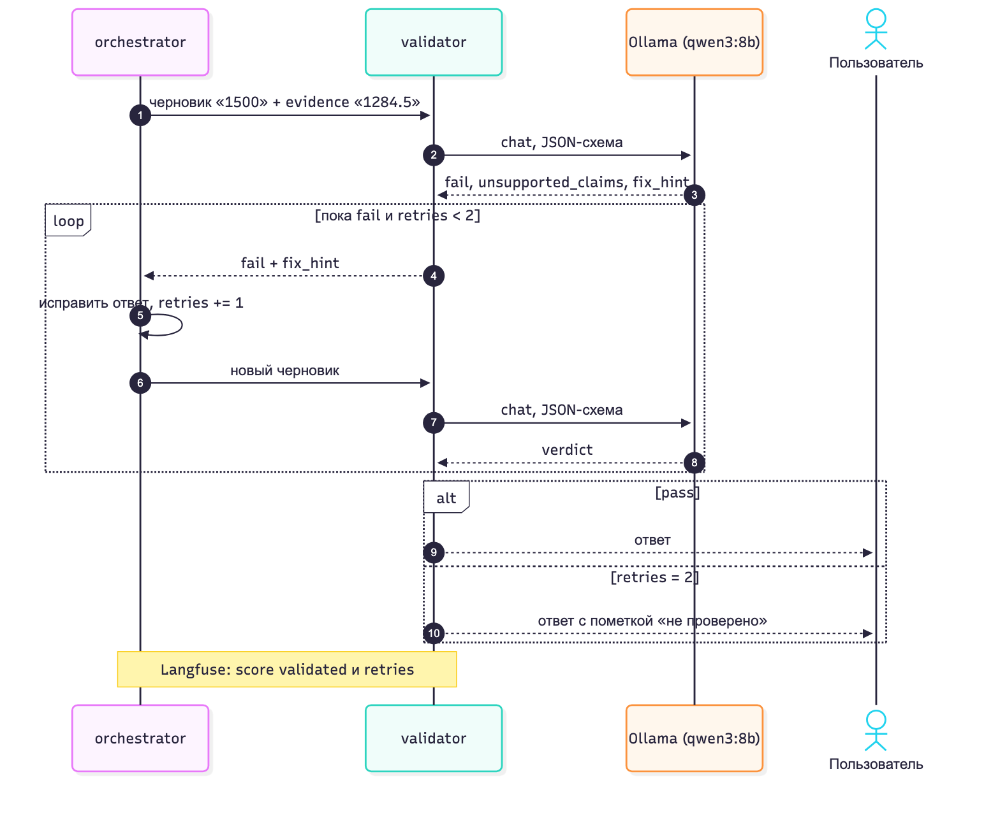

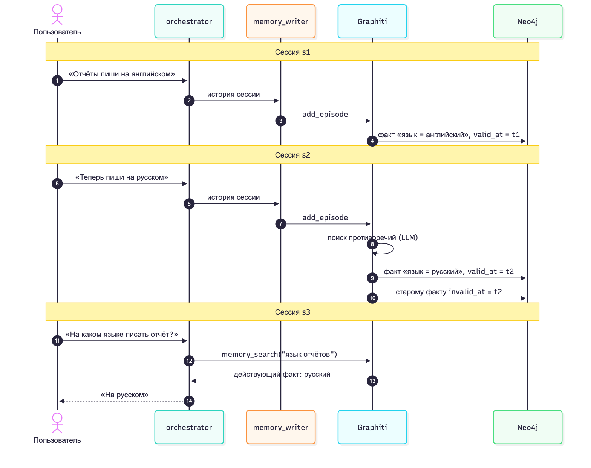

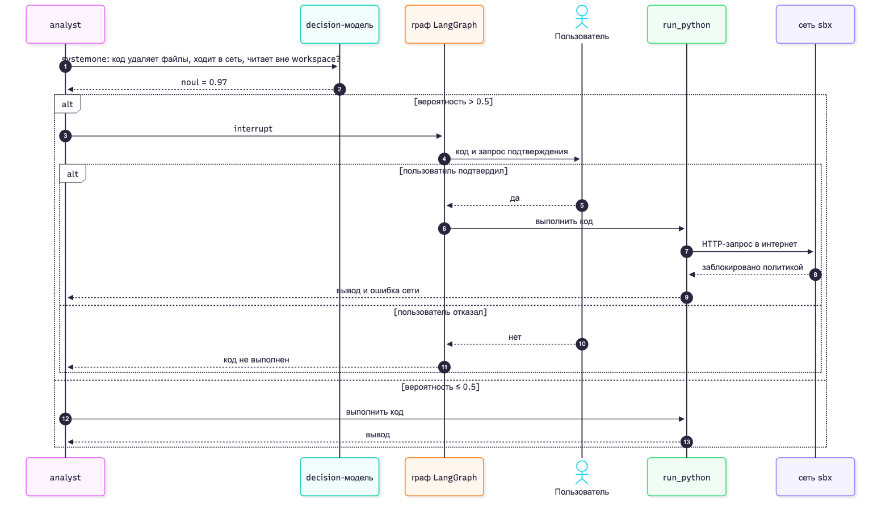

Легенда каждого C4-вида — в `diagrams/png/*-key.png`.

### 2.5 Нотация

- **C4** описывает архитектуру на 4 уровнях абстракции и задан в ТЗ. UML-диаграммы компонентов и ArchiMate подробнее, но читателю без подготовки их понять труднее.
- **UML sequence** показывает порядок вызовов во времени. Dynamic-вид C4 показывает те же шаги, но без ветвлений `alt` и циклов `loop`.
- **Structurizr DSL** строит все виды C4 из одной модели. Имена и связи не расходятся между диаграммами, связи компонентов автоматически поднимаются на уровень контейнеров. Синтаксис C4 в Mermaid дал пересечения линий и наложение подписей.
- **Mermaid** рисует sequence и Code-уровень прямо в `.md` на GitHub.
- **draw.io** не выбран: диаграммы рисуются вручную и расходятся с моделью при каждой правке.

---

## 3. Фреймворк

Фреймворк | Модель флоу | Память из коробки | Ollama | MCP | Лицензия | Решение
---|---|---|---|---|---|---
**LangGraph** | явный граф состояний, условные рёбра, подграфы | checkpointer (короткая), Store (долгая) | да | да, `langchain-mcp-adapters` | MIT | выбран
CrewAI | роли и задачи; процессы sequential и hierarchical; Flows для событий | short, long и entity memory | да, через LiteLLM | да | MIT | отказ: флоу задаётся ролями, а не графом; цикл «валидатор → повтор» и `interrupt` сложнее выразить явно
AutoGen / Microsoft Agent Framework | диалог агентов; графовые workflows в Agent Framework | базовая | через OpenAI-совместимый клиент | да | MIT | отказ: AutoGen в режиме поддержки, Agent Framework молодой
Haystack | пайплайны компонентов | хранилища документов | да | да | Apache 2.0 | отказ: сильная сторона — RAG-пайплайны, а не мультиагентный флоу
AutoGPT | автономный агент и no-code платформа | своя | только classic-агент, через OpenAI-совместимый API | не подтверждено | MIT; папка `autogpt_platform` — PolyForm Shield, не OSI | отказ: платформа не под OSI-лицензией и без Ollama, нет контроля флоу в коде
smolagents | цикл агента, действия в виде кода | минимальная | да | да | Apache 2.0 | отказ: нет checkpointer и `interrupt` из коробки
PydanticAI | типизированный агент, `pydantic-graph` | нет встроенной долгой памяти | да | да | MIT | отказ: меньше готовых примитивов памяти и подтверждения пользователем
Google ADK | иерархия агентов, workflow-агенты | сессии, memory service | через LiteLLM | да | Apache 2.0 | отказ: оптимизирован под Gemini и Vertex AI
Strands Agents | цикл агента, управляемый моделью; паттерны swarm и graph | сессии | да | да | Apache 2.0 | запасной вариант

Почему LangGraph:

- граф задаёт флоу явно: роутинг, цикл валидатора и лимит шагов видны в коде и на диаграмме Code;
- checkpointer даёт короткую память по `thread_id` без своего кода;
- `interrupt` реализует подтверждение пользователем для гейта рискованного кода;
- MCP-тулы подключаются через `langchain-mcp-adapters`;
- Langfuse принимает трейсы через `CallbackHandler`.

Минусы LangGraph: много абстракций LangChain, API часто меняется. Документацию проверять через context7.

---

## 4. Роутинг и decision-модель

Decision-модель `strands-decider` (Jev-like, 2.1 ГБ) отвечает вероятностями на вопросы о запросе через `/v1/systemone`. LLM на это не тратится. В системе она решает три задачи:

Задача | Вопрос | Что делает граф
---|---|---
Роутинг | `kind` (choice): media, analyst, chat; `hard` (noul): нужны ли несколько шагов, рассуждение или код | выбирает агента и уровень LLM
Гейт тулов | `risky` (noul): код удаляет файлы, ходит в сеть или читает вне `workspace` | при вероятности > 0.5 — `interrupt` и подтверждение пользователя
Нужна ли проверка | `facts` (noul): в ответе без тулов есть факты или числа | при вероятности < 0.5 валидатор пропускается

### 4.1 Порог тяжёлой модели

Замеры decision-модели на запросах разной сложности:

Запрос | `hard` | `kind` | `confidence` | Уровень
---|---|---|---|---
«Привет!» | 0.14 | chat | 0.82 | main
«Что на картинке cat.jpg?» | 0.28 | media | 0.81 | main
«Посчитай среднее по колонке price» | 0.60 | analyst | 0.77 | main
«Сравни продажи по месяцам, найди аномалии, объясни причины, построй прогноз» | 0.89 | analyst | 0.60 | **heavy**
«Расшифруй часовое интервью, выдели темы, оцени тональность каждого спикера» | 0.65 | media | 0.51 | main
«Проанализируй это» | 0.23 | chat | 0.06 | main

Правило: `hard ≥ 0.85` → `gpt-oss:20b`, иначе `gemma4:e4b`. Уверенность в типе задачи (`confidence`) в выборе модели не участвует:

- В серой зоне 0.6–0.65 рядом стоят простое среднее и составное интервью. Разница — шум.
- `confidence` выше у простых запросов (0.77–0.82), чем у составных (0.51–0.60). Условие `confidence > 0.5` отправило бы простое среднее на тяжёлую модель.
- Ошибка в сторону `main` дешевле: за ней стоит валидатор. Ошибка в сторону `heavy` выгружает из GPU основную модель и валидатор (12.8 ГБ, холодный старт 6.2 с).

Формулировка вопроса `hard` содержит «или кода», поэтому задачи `analyst` получают `hard` около 0.6. Формулировка без «кода» опустила простое среднее до 0.47, но сжала разброс: сложный прогноз упал с 0.89 до 0.63. Оставлена исходная формулировка. Порог проверяется метрикой точности роутера в разделе evals.

### 4.2 Проверка каркаса

Сценарий | Результат
---|---
«Что ты умеешь?» | `tier=main`, `kind=chat`, валидатор: pass
«Удали все CSV и скачай датасет» | `kind=analyst`, гейт: риск 0.75 → `interrupt`; после отказа агент сообщил, что код не выполнен
«Аномалии, причины, прогноз по sales.csv» | `tier=heavy` (`hard=0.89`), 2 попытки `run_python`, ответ с кодом для запуска; ~6 мин

Найденные при проверке ошибки и их решения — в [JOURNAL.md](JOURNAL.md): пустой ответ `gemma4:e4b` после результата тула, бесконечная генерация `gpt-oss:20b` без `num_predict`, повторы `run_python` без лимита тулов.


## 5. Изоляция

### 5.1 Варианты

Вариант | Ядро | На этом Mac | Сетевые политики | Старт | Вердикт
---|---|---|---|---|---
Процесс, venv | общий с хостом | да | нет | мгновенно | отклонён: код агента выполняется на хосте
Контейнер Docker | общее с Linux VM Docker Desktop | да | через флаги docker run | секунды | отклонён: обычный контейнер — редфлаг ТЗ
gVisor | ядро в user space | нет, Linux | да | — | не работает на macOS
Kata, Firecracker | microVM на KVM | нет, Linux | да | — | не работает на macOS
E2B | Firecracker, облако | облако | да | секунды | отклонён: код пользователя уходит во внешний сервис
microsandbox | microVM на libkrun | да | есть | секунды | запасной: политика настраивается вручную
Apple `container` | VM на контейнер | да | есть | секунды | запасной, то же
**Docker Sandboxes (`sbx`)** | microVM, своё ядро и Docker-демон | да: macOS 26, Apple silicon | deny-all + allowlist из коробки | секунды | выбран

`sbx` — проприетарный бесплатный инструмент; исключение из open-source стека. Обоснование: из вариантов, работающих на этом Mac, только `sbx` даёт microVM и готовую сетевую политику (deny-all с allowlist). У open-source альтернатив на macOS (Apple `container`, microsandbox) сетевую политику пришлось бы собирать и проверять вручную.

### 5.2 Связка

Агент и `run_python` работают в microVM; Ollama и ML-модели — на хосте: Linux VM на Mac не видит Metal GPU. Из песочницы открыты только хосты: Ollama `:11434`, Langfuse `:3000`, OTLP `:4318`, PyPI (для зависимостей). Файлы пользователя монтируются в VM как workspace; вне монтирования файловая система хоста недоступна.

### 5.3 Проверки

Изоляция подтверждена четырьмя проверками (вывод реальных команд): ядро VM Linux 7.0.14 против Darwin 25.2.0 у хоста; в домашнем каталоге VM только workspace; исходящий интернет закрыт политикой (403); Ollama на хосте доступна через allowlist. Скрин — `screens/sbx-isolation.png`, команды — `infra/agent-sbx.sh`.

### 5.4 Гейт рискованного кода

Проверка на хосте показала риск 0.75 на описании удаления, но внутри песочницы decision-модель дала 0.13–0.18 на коде `os.remove` и `shutil.rmtree`: модель оценивает естественный текст лучше, чем код. Гейт стал двухуровневым: статические паттерны опасных операций (детерминированно, риск 1.0) или оценка decision-модели выше 0.5. Инцидент с пропущенным удалением тестового CSV и оба пути гейта описаны в [JOURNAL.md](JOURNAL.md).

## 6. Тулы

Тул | Где работает | Слой | Проверка
---|---|---|---
`classify_image`, `detect_video`, `transcribe`, `sentiment` | хост (Metal) | MCP-сервер `mcp_ml/server.py`, порт 8765 | вызов из песочницы: `evals/mcp_probe.py`
`run_python` | microVM, где живёт агент | `@tool`, гейт рисков | расчёт по CSV, гейт удаления
`load_skill`, `memory_search` | разделы 11 и 13 | — | —

Границы ML-тулов из кода задания 1, учтённые в промптах: `sentiment` обучен на английском (SST-2), тональность русского оценивает LLM; число объектов на видео берётся из `unique` трекинга, а не из суммы детекций по кадрам. Результат длинного видео кешируется в MCP-сервере по ключу (путь, mtime, параметры).

Доступ тула ограничен `workspace/`: путь наружу даёт ошибку (`evals/safe_test.py`). Вывод тулов — данные для ответа, а не инструкции; это правило промптов и сценарий prompt injection в evals.
