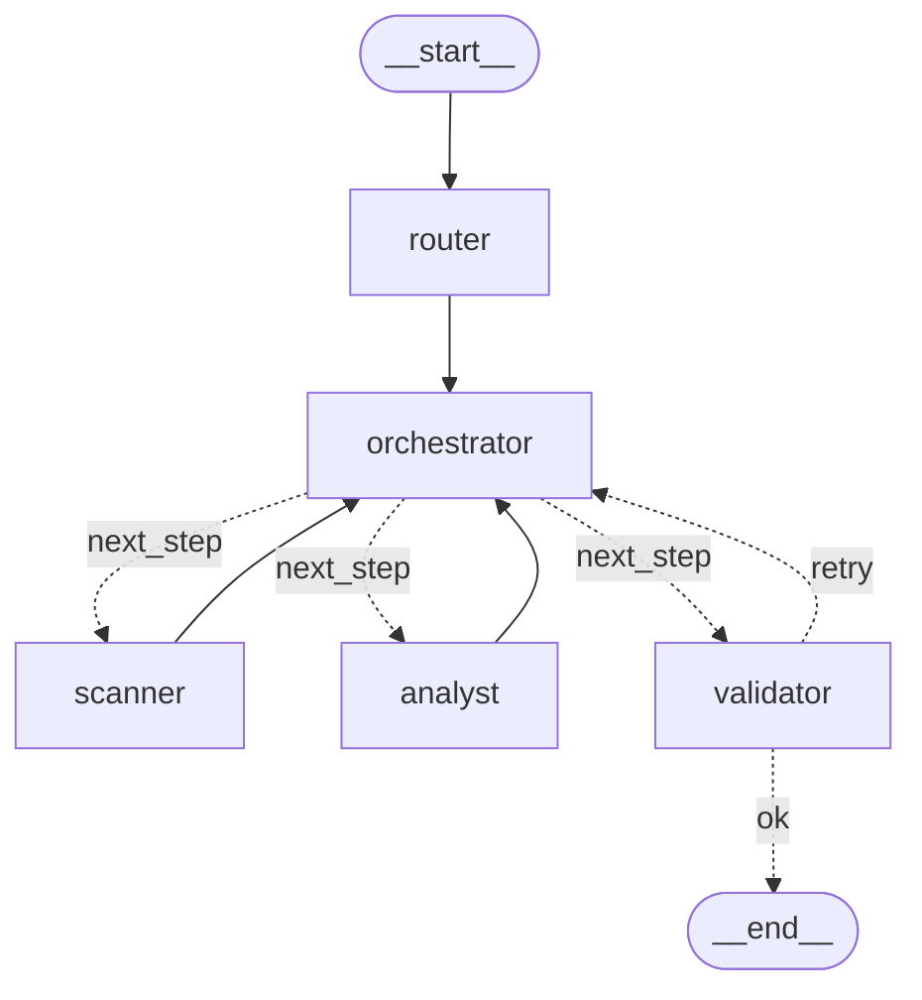
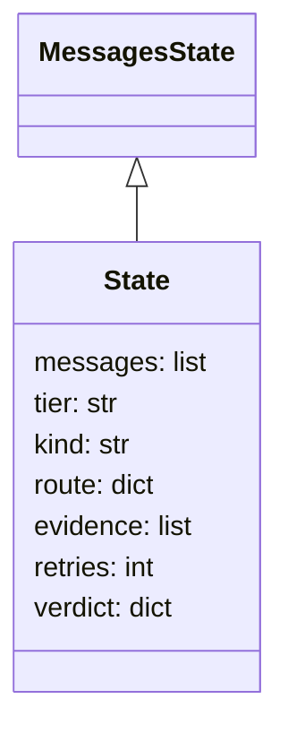
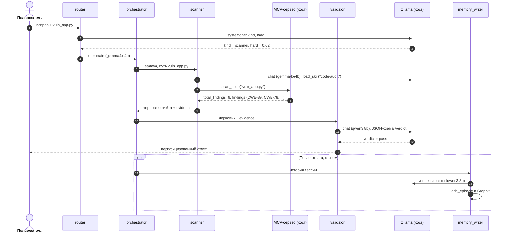
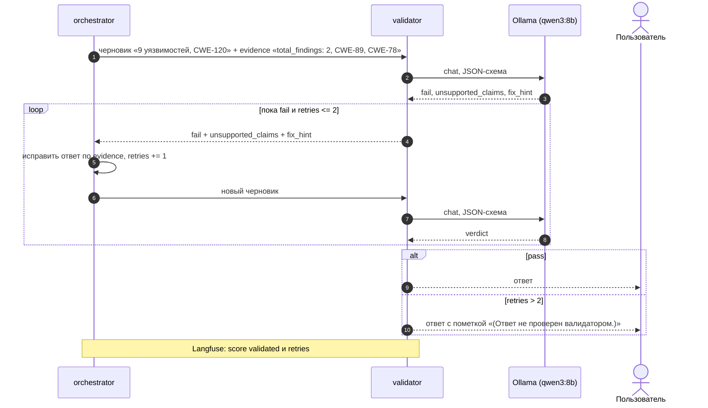
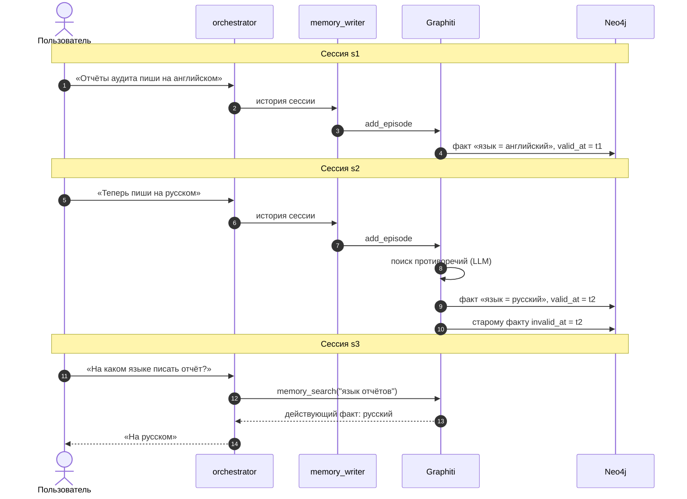
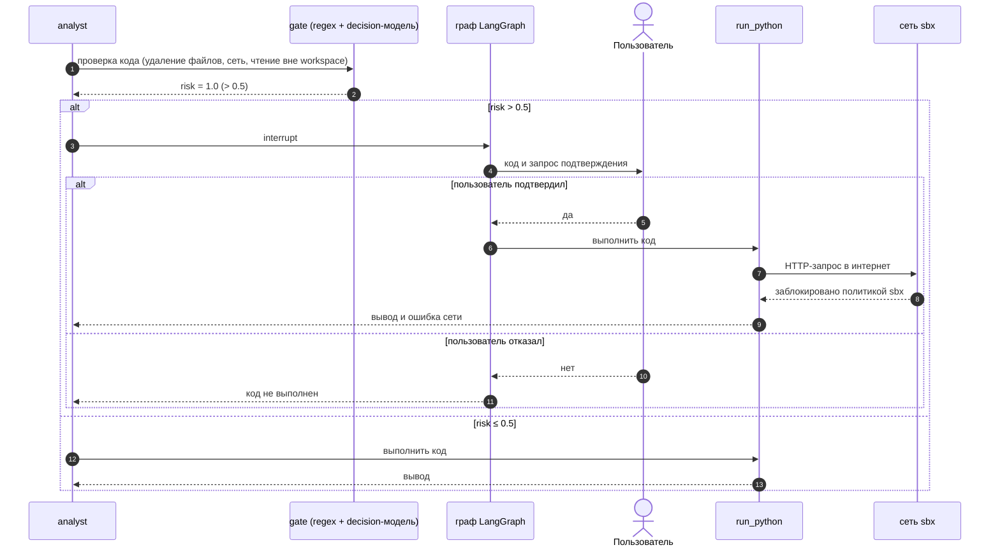

# Диаграммы: аудитор безопасности (Security Reviewer)

Диаграммы системы лежат в двух файлах:

- [workspace.dsl](workspace.dsl) — C4-модель в Structurizr DSL. Из одной модели строятся 6 видов: System Landscape, System Context, Container, Component, Dynamic, Deployment.
- этот файл — Code-уровень C4 и 4 UML sequence-диаграммы в Mermaid. Structurizr не моделирует код, а sequence — нотация UML, а не C4.

Архитектура взята из плана задания 3, раздел 6. Имена узлов (`router`, `orchestrator`, `scanner`, `analyst`, `validator`), портов и моделей сверены с кодом `agent/graph.py`.

## Как работать с моделью

Structurizr ставится через Homebrew: `brew install structurizr`.

```bash
# проверить модель
structurizr validate -w task3-agent/diagrams/workspace.dsl

# экспорт всех видов в PNG (рендер офлайн, сервер не нужен)
structurizr export -w task3-agent/diagrams/workspace.dsl -f png -o task3-agent/diagrams/png

# UI для ручной раскладки: http://localhost:8080
structurizr local task3-agent/diagrams
```

`structurizr local` пишет в каталог `workspace.json` и `.structurizr/`. `workspace.json` хранит ручную раскладку, его можно коммитить. `.structurizr/` — индекс и логи, его коммитить не нужно.

Mermaid-диаграммы этого файла рендерятся так:

```bash
npx -p @mermaid-js/mermaid-cli mmdc -i task3-agent/diagrams/diagrams.md -o task3-agent/diagrams/mermaid/rendered.md -e png -s 2
```

Команда пишет `rendered-1.png` … `rendered-6.png` в порядке блоков. В репо они переименованы: `code-graph.png`, `code-state.png`, `seq-1-main.png` … `seq-4-gate.png`.

---

## Code

Граф LangGraph и структура его state. Сверено с `app.get_graph().draw_mermaid()`: узлы и рёбра совпадают. Подписи условных рёбер добавлены вручную: `draw_mermaid()` их не рисует.





---

## Sequence 1. Основной флоу аудита кода

Запрос на SAST-проверку файла от входа до верифицированного ответа и записи в память.



## Sequence 2. Отказ валидатора

`validator` находит неподтверждённый CWE/номер строки или число без опоры на `evidence`. `orchestrator` переделывает ответ, максимум 2 раза.



## Sequence 3. Обновление долгой памяти

Новый факт противоречит старому. Graphiti закрывает старый факт, и в ответ попадает только действующий.



## Sequence 4. Гейт рискованного тула

Гибридный гейт (статические паттерны `RISKY_CODE` + decision-модель) проверяет код перед `run_python`. Рискованный код выполняется только после подтверждения пользователя. Сеть microVM блокирует выход в интернет в любом случае.


